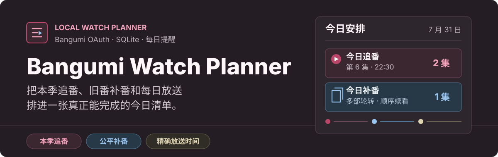

<p align="center">
  
</p>

# Bangumi Watch Planner

把今天要追的新番、想补的旧番和观看进度放在一起。本地运行，连接 Bangumi 收藏，跟随新番放送时间，自由选择想补的旧番。

**[下载 v1.4.0](https://github.com/Tr1meputiNe/bangumi-watch-planner/releases/tag/v1.4.0)** · [启动与配置](#下载和启动) · [补番与进度](#补番与进度) · [历史版本](#保留的发行版)


*界面示意，实际布局以下载版本为准。*

> 下载、解压、双击启动；不需要安装 Node.js、Git 或运行命令。首次连接只需粘贴 Bangumi 个人令牌，不必创建开发者应用。数据保存在本机，收藏和分集进度同步到 Bangumi。

## 主要功能

- **今日**：本季已播出待看与最近补番分区显示，可记录观看进度，随时接着看。
- **追番**：只显示活动季度内仍在更新的动画，可展开完整分集并修正进度。
- **补番**：按真实观看记录自动显示最近在看；完整片库支持搜索、排序和按需挑选，没有每日任务或完成期限。
- **想看**：读取 Bangumi“想看”列表，支持名称和年份筛选；未播出的动画不会进入追番或补番。
- **每日放送**：显示日期、小时和数据来源，可保存整部动画的本地时间偏移。
- **后台同步**：页面打开时每分钟增量检查，只拉取发生变化的分集；每天 `20:00 Asia/Shanghai` 完整校准并按天去重发送汇总提醒。

## 下载和启动

打开 [v1.4.0 下载页](https://github.com/Tr1meputiNe/bangumi-watch-planner/releases/tag/v1.4.0)，按电脑选择安装包，不要下载自动生成的 `Source code`。

| 电脑 | 下载文件结尾 |
| --- | --- |
| Windows 10 / 11，Intel 或 AMD 处理器 | `windows-x64.zip` |
| Mac，Apple 芯片（M 系列） | `macos-arm64.zip` |
| Mac，Intel 处理器 | `macos-x64.zip` |

### Windows 10 / 11

1. 解压到固定目录，不要在压缩包预览里运行。
2. 双击 `Start Bangumi Watch Planner.cmd`，网页会自动打开。
3. 首次使用按页面指引连接 Bangumi；以后双击启动即可。

需要开机后继续提醒时，可双击 `Install Startup.cmd`；`Uninstall Startup.cmd` 移除启动项。

便携包中的 `Bangumi-Watch-Planner.exe` 是服务本体，旁边的 `node_modules` 和 `dist` 目录必须保留。当前版本没有商业代码签名，Windows SmartScreen 可能在首次运行时提示确认；Release 同时提供 `SHA256SUMS.txt` 用于核对下载文件。

### macOS

需要 macOS 13.5 或更高版本。

1. 解压，把 `Bangumi Watch Planner.app` 放到“应用程序”或其他固定目录。
2. 双击应用，网页会自动打开。
3. 首次使用按页面指引连接 Bangumi；以后双击应用即可。

应用内置运行环境，数据保存在 `~/Library/Application Support/BangumiWatchPlanner`。升级时替换 `.app` 即可，数据目录不用移动。关闭网页后，本地服务会继续运行；重新登录电脑后再双击应用启动。

目前安装包未经过商业签名或 Apple 公证，首次打开可能出现系统来源确认。已有源码部署可以继续使用原目录；请保留原来的 `data/` 数据目录和配置。

### 自行部署

仅供开发或服务器部署：安装 Node.js 22 或更高版本，克隆本仓库后运行：

```bash
npm ci
npm run build
npm start
```

生产服务默认只监听 `127.0.0.1:3777`。需要局域网访问时，在 `.env.local` 中设置 `HOST=0.0.0.0`。

## 连接 Bangumi

推荐使用个人令牌，不需要 App ID、App Secret 或回调地址：

1. 在应用首页点击“获取个人令牌”，打开 [Bangumi 官方令牌页面](https://next.bgm.tv/demo/access-token)。
2. 登录 Bangumi，创建令牌并选择有效期。
3. 把令牌粘贴回应用，点击连接。验证后会自动同步。

令牌只保存在你的本机服务中；过期或撤销后重新生成并粘贴即可。不要把令牌发给别人。

### 使用 OAuth（可选）

已有开发者应用可展开首页的高级选项，继续使用 OAuth：

1. 在 [Bangumi 开发者平台](https://bgm.tv/dev)创建应用。
2. 本机使用时，把回调地址填写为：

   ```text
   http://127.0.0.1:3777/auth/callback
   ```

3. 启动应用，在登录页填写 Bangumi App ID 和 App Secret。
4. 点击“使用 Bangumi 登录”并完成授权。首次同步会在回到首页后继续执行，不会卡住登录跳转。

如果把 `data/` 复制到另一台 Mac，需要在新电脑重新登录：refresh token 保存在原电脑的 Keychain 中，不随 SQLite 数据库迁移。

也可以复制环境文件：

```bash
cp .env.example .env.local
```

```text
BANGUMI_CLIENT_ID=你的 App ID
BANGUMI_CLIENT_SECRET=你的 App Secret
APP_BASE_URL=http://127.0.0.1:3777
```

如果服务部署在另一台主机，`APP_BASE_URL` 和 Bangumi 开发者平台中的回调地址必须完全一致，并且浏览器能够访问该地址。

## 补番与进度

补番按自己的节奏进行，不再自动分配每日任务、未来七天计划或预计完成日期。未观看不会产生欠账，也不会发送补番任务提醒。

- **最近在看**：按观看记录时间自动排序，普通同步、评分、评价、搁置和恢复不会把动画置顶。本地点击使用记录当时的时间；远端同步只使用已看分集的有效时间，也可据此补全旧缓存。远端时间未知时保留为空，不用同步时间或收藏更新时间推测。
- **全部待补**：支持中文名、原名搜索，以及最近看过、名称和剩余集数排序；片库较大时分批显示。
- **帮我挑一部**：主动点击才从片库给出候选；不会改变收藏状态或安排任务。
- **记录进度**：分集格沿用原来的直接点击方式：未看的本篇点到哪集就记录到哪集，已看的点击取消，特别篇单独记录；不增加额外的选择步骤。进度数量按实际已看的本篇计算。

总集数可信且本篇全部看完时，旧番会自动改为 Bangumi“看过”。总集数未知时不会擅自完成，可在展开的观看进度中手动处理。

## 季度和放送时间

季度数据优先采用 [Yuc Wiki](https://yuc.wiki/)。每季度以最早的正常首播日为第一天，之后 14 个自然日允许新旧季度共存；跨季续播动画会继续留在追番。

Yuc Wiki 的播出时间已是中国时间，直接使用，不再减一小时。`25:00` 等 30 小时制写法仅规范为次日 `01:00`，再参与星期与每日负载计算。缺少 Yuc Wiki 数据时，会依次回退到 Bangumi Index、Bangumi Data 和 Bangumi 日历。页面中的“校正时间”可保存日期差和播出小时，“恢复来源”会删除本地修正。

## 后台提醒

| 平台 | refresh token | 系统提醒 | 后台启动 |
| --- | --- | --- | --- |
| macOS | Keychain | `osascript` 通知 | LaunchAgent |
| Windows | 当前用户 DPAPI | Windows Toast | 启动文件夹快捷方式 |
| Linux | 权限为 `0600` 的本地文件 | 写入服务日志 | 由 systemd 等服务管理器负责 |

提醒默认每天 `20:00 Asia/Shanghai` 执行，先同步，再汇总已播出待看的新番；同一天只发送一次。可在 `.env.local` 修改：

```text
REMINDER_CRON=0 20 * * *
NOTIFICATIONS_ENABLED=true
```

## 局域网访问

先在运行主机的 `.env.local` 中设置 `HOST=0.0.0.0` 并重启服务。

同一网络中的设备可以打开运行主机的 `3777` 端口。例如 Mac 的地址是 `192.168.1.23`，手机可访问：

```text
http://192.168.1.23:3777/
```

OAuth 重新授权仍应在运行服务的电脑上完成。局域网访问无需密码；任何能访问该端口的设备都能查看追番数据并修改收藏和进度。仅在可信网络使用，不要把端口转发到公网。

## 收藏状态

| Bangumi 状态 | 本地用途 |
| --- | --- |
| `1` 想看 | 保留在想看，不自动改为在看 |
| `3` 在看 + 活动季度 | 本季追番 |
| `3` 在看 + 非活动季度 | 自由补番片库 |
| `4` 搁置 | 补番搁置 |
| `2` 看过 | 已完成 |

## 同步策略

首页始终先读取 SQLite 缓存，不等待 Bangumi 网络请求。至少有一个页面打开时，服务会立即执行一次增量检查，之后每分钟检查收藏摘要；所有页面关闭后停止分钟检查。只有摘要变化的动画才重新获取分集，Yuc Wiki 等公开放送数据最多每小时刷新一次。

“立即同步”执行增量检查；设置中的“立即校准”、版本升级后的首次同步和每天 `20:00` 执行完整校准。收藏与进度操作先写入本地持久队列并更新页面，再在后台串行写回 Bangumi；一分钟内持续失败时恢复旧状态，并在设置中保留重试入口。

封面优先由本地服务缓存转发，浏览器缓存一天，减少重复访问外部图片站。请求超时或失败时自动尝试原图地址，仍不可用时显示占位；恢复联网后自动重试。图片服务仅允许 Bangumi 封面地址，不转发任意网址。

## 隐私

- Bangumi App Secret 只保存在本机环境文件或 SQLite 设置中。
- access token 和 refresh token 不会发送到前端或提交到 Git。本地写入令牌通过 `HttpOnly` Cookie 发给浏览器，用于防止跨站请求，不限制局域网设备访问。
- 应用使用 OAuth，不保存 Bangumi 账号密码。
- `.env.local`、`data/` 和 `logs/` 已加入 `.gitignore`。

## 开发

```bash
npm ci
npm run dev
```

前端开发服务器位于 `http://127.0.0.1:5173`，API 代理到 `3777`。

提交前运行：

```bash
npm test
npm run lint
npm run build
git diff --check
```

Windows、Apple 芯片 Mac 和 Intel Mac 安装包由 `.github/workflows/release.yml` 在推送 `v*` 标签后分别构建。每个平台都会实际启动打包产物，检查 SQLite 和网页资源；三种产物全部通过后才发布 Release。

## 保留的发行版

日常使用请选择 **v1.4.0**。以下旧版保留供回退，功能与修复以各版本说明为准。

| 版本 | 用途 |
| --- | --- |
| [v1.4.0](https://github.com/Tr1meputiNe/bangumi-watch-planner/releases/tag/v1.4.0) | 当前推荐版本，免运行环境与个人令牌连接 |
| [v1.3.1](https://github.com/Tr1meputiNe/bangumi-watch-planner/releases/tag/v1.3.1) | 历史版本 |
| [v1.2.1](https://github.com/Tr1meputiNe/bangumi-watch-planner/releases/tag/v1.2.1) | 历史版本 |
| [v1.1.3](https://github.com/Tr1meputiNe/bangumi-watch-planner/releases/tag/v1.1.3) | 历史版本 |
| [v1.0.0](https://github.com/Tr1meputiNe/bangumi-watch-planner/releases/tag/v1.0.0) | 初始版本 |
